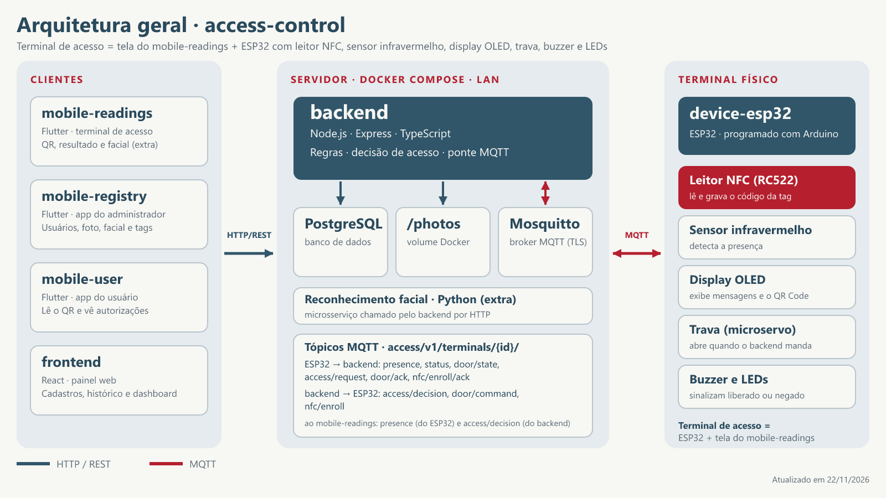
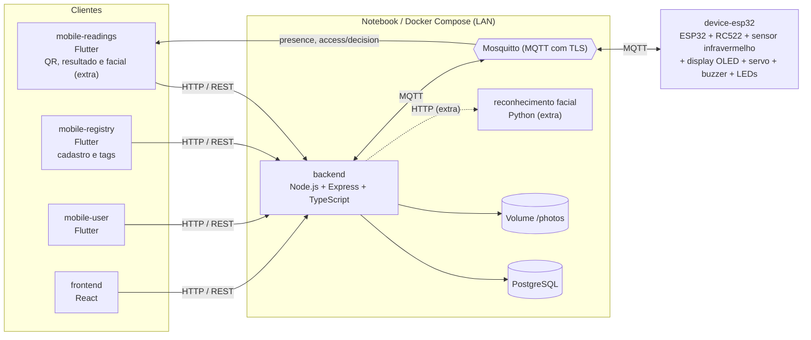
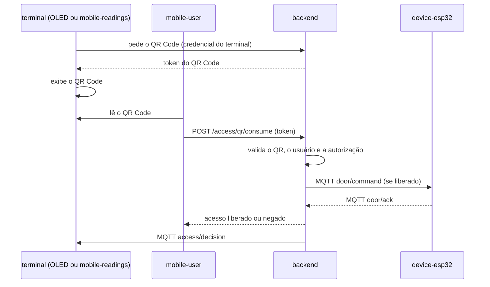
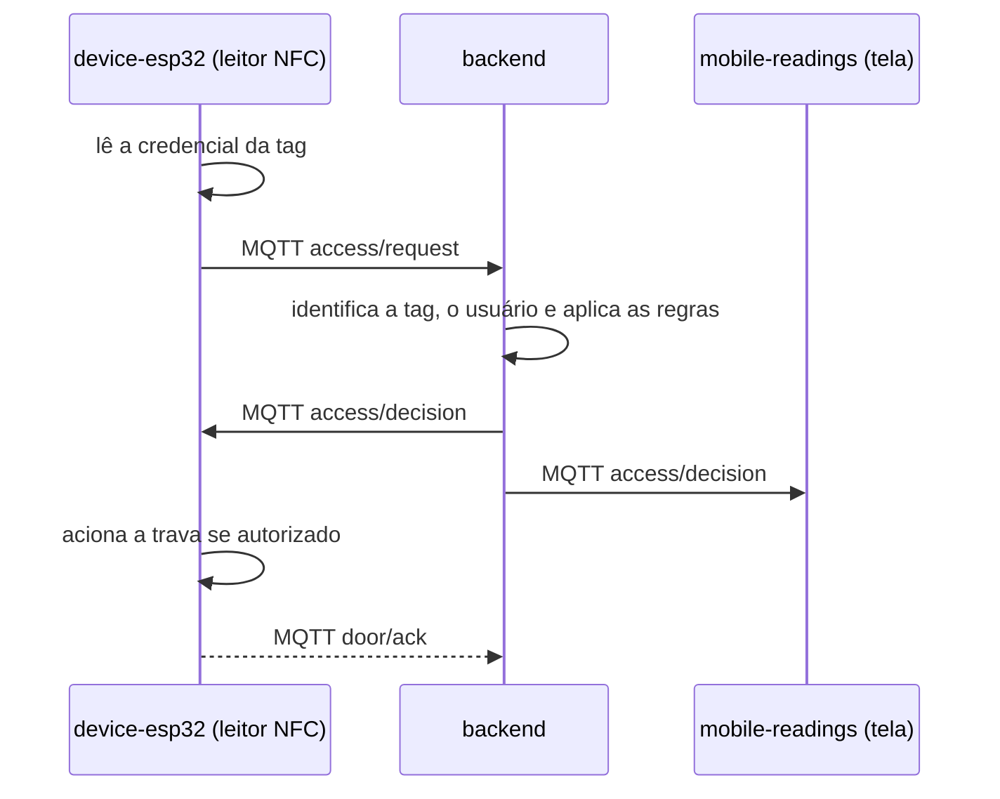
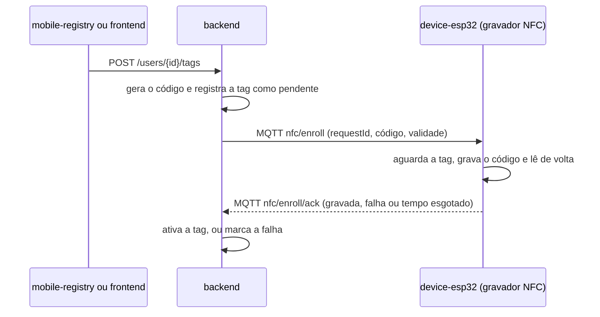
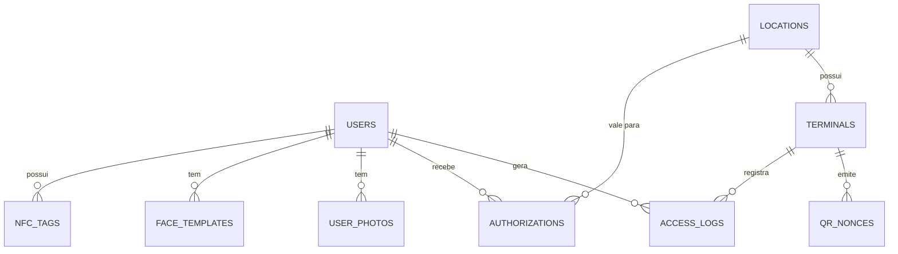

# Arquitetura do access-control

Documentação da arquitetura do Sistema Integrado de Controle de Acesso (ABP 2026-2, 4º DSM, FATEC Jacareí). Atende ao item RP07 do desafio: desenho da arquitetura e descrição da comunicação entre os elementos do sistema. Atualizada em 22/11/2026, na Sprint 3.

> Base: [`access-control-visao-geral.docx`](./access-control-visao-geral.docx), que detalha cada serviço. **Atenção:** a leitura e a gravação de tags NFC são feitas por um **único ESP32** (programado com Arduino), com leitor NFC. O celular não usa NFC: por definição do professor, o terminal de acesso (app mobile-readings) não lê tags. O `.docx` ainda descreve a leitura no celular; neste ponto, **este documento prevalece**. As rotas HTTP estão em [`api.md`](./api.md) e as mensagens MQTT em [`contrato-mqtt.md`](./contrato-mqtt.md). O estado de cada parte, com o que já existe e o que ainda não chegou à `main`, está na seção 11.

## 1. Visão geral

Para a integração do ESP32 na demonstração, siga o [contrato MQTT v1](./contrato.md) para tópicos, mensagens e responsabilidades dos clientes.

O sistema libera uma catraca ou fechadura a partir de uma credencial lida por **QR Code** ou **tag NFC**, com validação centralizada em um backend e registro de toda tentativa de acesso. O **reconhecimento facial** é uma funcionalidade extra (seção 9).

**Princípio central:** apps e dispositivo **nunca decidem o acesso**.

| Quem | Faz |
|---|---|
| mobile-readings (terminal) | Exibe o QR Code e o resultado do acesso, e captura a imagem para o reconhecimento facial (extra). **Não usa NFC** |
| mobile-user | Lê o QR Code e o encaminha ao backend |
| mobile-registry e frontend | Cadastram usuários e vinculam tags NFC. O pedido de gravação de tag parte do backend para o ESP32 |
| ESP32 | **Lê tags NFC** (RC522), detecta presença (sensor infravermelho), exibe o QR Code no display OLED, aciona a trava e sinaliza com LEDs e buzzer |
| Backend | Gera o QR Code, valida, registra o evento e ordena a abertura |

A arquitetura é distribuída, com separação clara entre dispositivo, backend e aplicativos (RP05), e foi pensada para rodar inteiramente em **rede local (LAN)**, sem depender de internet na apresentação.

## 2. Diagrama

O desenho também está em [SVG](./imagens/arquitetura-geral.svg), para edição.

## 3. Serviços

| Serviço | Tecnologia | Responsabilidade |
|---|---|---|
| `mobile-readings` | Flutter | **Terminal de acesso (tela).** Exibe o QR Code, escuta presença e a decisão de acesso e mostra o resultado (liberado ou negado). Captura a câmera para o reconhecimento facial, como extra. Não lê NFC |
| `mobile-registry` | Flutter | **App do administrador.** Cadastro de usuários, tags NFC, foto reduzida (cerca de 50 KB) e dado facial |
| `mobile-user` | Flutter | **App do usuário.** Login, lista de autorizações e leitura do QR Code |
| `backend` | Node.js, Express, TypeScript, Prisma, PostgreSQL | **Núcleo do sistema.** Regras de negócio, geração do QR Code, decisão de acesso, persistência e ponte com o MQTT |
| `frontend` | React | **Painel web.** Usuários, tags, locais, terminais, autorizações, histórico, exportação e dashboard |
| `device-esp32` | ESP32 (Arduino), RC522, sensor infravermelho, display OLED, microservo, buzzer e LEDs | **Terminal físico.** Lê tags NFC, detecta presença, exibe o QR Code, aciona a trava e sinaliza |

### Estrutura do backend

| Camada | Função |
|---|---|
| `routes` | Monta as rotas sob o prefixo `/api` |
| `controllers` | Uma função por operação: login, usuários e tags, locais, terminais, autorizações, histórico e acesso |
| `middlewares` | JWT, perfil de administrador, credencial do terminal, upload de foto, limite de requisições e erros |
| `models` | Modelos de resposta e DTOs com validação (Zod) |
| `services` | Abertura da porta, MQTT e cliente do serviço de reconhecimento facial |
| `config` | Variáveis de ambiente, Prisma e pasta de fotos |

O núcleo de decisão é único: QR Code, NFC e facial convergem para a mesma validação, mudando apenas a forma de identificar a pessoa.

## 4. Comunicação entre os elementos

| Origem | Destino | Protocolo | Uso |
|---|---|---|---|
| Apps e frontend | backend | HTTP / REST | Cadastros, autenticação, validação de acesso por QR, consultas |
| backend | ESP32 | MQTT, via Mosquitto | Decisão de acesso, comando de abertura e pedido de gravação de tag |
| ESP32 | backend | MQTT | Presença, estado, pedido de acesso por NFC e confirmações (ack) |
| backend | mobile-readings | MQTT | Decisão de acesso, para a tela do terminal |
| ESP32 | mobile-readings | MQTT | Evento de presença (somente leitura) |
| backend | reconhecimento facial | HTTP | Cadastro e comparação de rostos (extra) |
| backend | PostgreSQL | SQL | Dados de usuários, autorizações e histórico |
| backend | disco | Sistema de arquivos | Fotos reduzidas em `/photos` (volume Docker) |

### 4.1 Interfaces HTTP

As rotas ficam sob o prefixo `/api` e estão detalhadas em [`api.md`](./api.md).

| Grupo | Rotas principais | Consumidor |
|---|---|---|
| Autenticação | `POST /login` | Todos os apps e o frontend |
| Usuários | `GET/POST /users`, `PUT /users/{id}`, `PATCH /users/{id}/status` | mobile-registry, frontend |
| Tags NFC | `POST /users/{id}/tags`, `DELETE /users/{id}/tags/{tagId}` | mobile-registry, frontend |
| Face e foto | `POST /users/{id}/face`, `GET /users/{id}/photo` | mobile-registry, frontend |
| Locais e terminais | `/locations`, `/terminals` | frontend |
| Autorizações | `GET/POST /authorizations`, `GET /authorizations/me`, `PATCH /authorizations/{id}/cancel` | frontend, mobile-user |
| Histórico | `GET /access-logs` | frontend |
| QR Code do terminal | `POST /terminals/me/qr`, `GET /terminals/{id}/qr`, `/status`, `/faces` | terminais |
| Acesso | `POST /access/qr/consume` (usuário), `POST /access/nfc` e `POST /access/face` (terminal) | mobile-user, terminais |
| Operação | `GET /health` | Docker, CI/CD e monitoramento |

O acesso por NFC chega ao backend pelo tópico MQTT `access/request`. A rota `POST /access/nfc` é o caminho equivalente por HTTP.

### 4.2 Tópicos MQTT

Contrato v1, detalhado em [`contrato-mqtt.md`](./contrato-mqtt.md). Todos os tópicos têm o prefixo `access/v1/terminals/{terminalId}/`.

| Tópico | Sentido | Conteúdo |
|---|---|---|
| `presence` | ESP32 → backend e mobile-readings | `{detected, distanceCm, occurredAt}` |
| `status` | ESP32 → backend | Sinal de vida do terminal |
| `door/state` | ESP32 → backend | `{state: "OPEN" \| "CLOSED"}` |
| `access/request` | ESP32 → backend | `{requestId, credential: {type: "NFC", value}}`: pedido de decisão para a tag lida |
| `access/decision` | backend → ESP32 e mobile-readings | `{requestId, authorized, reason, unlockDurationMs, expiresAt}` |
| `door/command` | backend → ESP32 | Comando de abertura da trava |
| `door/ack` | ESP32 → backend | `{requestId, result}`: confirmação de execução (`UNLOCKED`, `EXPIRED` ou `ERROR`) |
| `nfc/enroll` | backend → ESP32 | Pedido para gravar um código na próxima tag apresentada |
| `nfc/enroll/ack` | ESP32 → backend | Resultado da gravação |

Regras: todas as mensagens levam `schemaVersion`, `eventId` e `terminalId`; QoS 1 nas decisões e nos comandos; o pedido de acesso vale por 5 segundos; o sinal de vida tem janela de 30 segundos; a abertura dura 3 segundos; mensagens retidas são ignoradas; o ESP32 mantém a porta travada se a decisão não chegar a tempo, vier repetida ou já tiver expirado. O broker usa TLS e ACL por tópico.

### 4.3 Leitor NFC no ESP32

- **Hardware:** leitor RC522 de 13,56 MHz, ligado ao ESP32 por SPI e alimentado em 3,3 V.
- **Leitura no acesso:** o firmware lê a credencial da tag, aplica um intervalo mínimo entre leituras da mesma tag e publica em `access/request`.
- **Gravação:** ao receber `nfc/enroll`, o ESP32 entra em modo de gravação por tempo limitado, grava o código na próxima tag, lê de volta para conferir e responde em `nfc/enroll/ack`.
- **Único dispositivo:** como o mesmo ESP32 lê e grava, durante a janela de gravação (poucos segundos) ele não processa acesso por NFC. O acesso por QR Code continua normalmente.
- **Independência do celular:** o terminal continua aceitando NFC mesmo com a tela do mobile-readings em repouso.

## 5. Fluxos principais

### 5.1 Acesso por QR Code

O backend valida, **nesta ordem**: QR existente e ainda não consumido (consumo atômico, uso único), validade, usuário ativo, autorização existente para o local, situação, janela de datas e horários e usos restantes. O resultado é sempre registrado (RF17). A proximidade geográfica (RF13) está prevista no motivo de negação `TOO_FAR`; seu estado está na seção 11.

### 5.2 Acesso por tag NFC

Aplicam-se as mesmas regras do QR Code, **sem** o teste de geolocalização, pois a tag foi apresentada fisicamente ao leitor. Uma credencial desconhecida ou de tag revogada gera registro com usuário nulo e decisão negada.

### 5.3 Cadastro e gravação de tag NFC

O administrador aproxima a tag do leitor do ESP32 depois de pedir a gravação no app ou no painel. A tag só passa a valer quando o ESP32 confirma a gravação. Em caso de falha ou de tempo esgotado, o pedido expira e pode ser repetido.

### 5.4 Presença e modo de escuta

O ESP32 detecta a presença com o sensor infravermelho de obstáculos: a presença contínua por três segundos libera a exibição do QR Code, e o afastamento antes disso cancela a contagem. O terminal publica `presence`. O mobile-readings fica em **repouso** (tela econômica e câmera desligada) e passa ao modo de **escuta** ao receber o evento, reduzindo consumo (RNF07). Se o MQTT falhar, o app consulta `GET /terminals/{id}/status` por polling.

## 6. Modelo de dados

| Entidade | Campos principais |
|---|---|
| `users` | id, nome, documento, e-mail, telefone, perfil, senha (hash), ativo |
| `nfc_tags` | id, user_id, UID, ativa, criada em |
| `face_templates` | id, user_id, embedding, versão do modelo, data do consentimento |
| `user_photos` | id, user_id, caminho do arquivo, tipo |
| `locations` | id, edifício, portaria, porta, catraca, descrição |
| `terminals` | id, location_id, latitude, longitude, segredo do QR, hash da chave, estado, última presença |
| `authorizations` | id, user_id, location_id, datas e horários, usos permitidos e realizados, situação |
| `access_logs` | id, user_id (nulo se desconhecido), terminal_id, método (QR, NFC ou FACE), resultado, motivo, distância, confirmação do comando |
| `qr_nonces` | hash do QR, terminal_id, validade, consumo |

O esquema vigente é o do backend, em `backend/prisma/schema.prisma`; esta seção é uma visão de referência. A contagem de usos é atualizada de forma **atômica**, para que dois acessos simultâneos não ultrapassem o limite, e o embedding fica em coluna própria, o que facilita proteger, excluir e invalidar por versão do modelo.

## 7. Segurança

| Tema | Medida |
|---|---|
| Autenticação de pessoas | Login com senha em hash (bcrypt) e token JWT com expiração |
| Autorização | Rotas administrativas só para administradores; o usuário só acessa as próprias autorizações |
| Autenticação dos terminais | Chave própria do terminal, guardada em hash. No MQTT, TLS e ACL por tópico: só o ESP32 daquele terminal publica em `presence`, `status`, `door/state`, `access/request` e `door/ack` |
| QR Code | Token aleatório de uso único, guardado em hash e com validade curta |
| Broker MQTT | Só o backend publica em `access/decision`, `door/command` e `nfc/enroll`; o mobile-readings só lê `presence` e `access/decision` |
| Dados biométricos | Embedding em coluna separada, consentimento registrado e exclusão prevista (LGPD) |
| Fotos | Nome aleatório, validação do conteúdo, limite de tamanho e acesso por endpoint autenticado |
| Entrada de dados | Validação de todos os payloads com esquema (Zod) |
| Abuso | Limite de requisições nos endpoints de QR |
| Transporte | HTTPS é o ideal. Na LAN de demonstração, HTTP é aceitável, com a limitação declarada (RNF02) |

> O tópico `door/command` é, na prática, a chave da fechadura. A ACL do Mosquitto deve ser testada antes de cada apresentação. Os tópicos `access/request` e `nfc/enroll` também precisam de ACL: quem publica em `access/request` simula uma tag, e quem publica em `nfc/enroll` escolhe o que é gravado.

**Limitação conhecida:** uma tag pode ser copiada com o código dentro, e a cópia seria aceita como a original. A mitigação é revogar a tag no backend.

## 8. Infraestrutura e implantação

- **Entrega final:** execução **local com Docker Compose** (backend, PostgreSQL, Mosquitto com TLS, frontend e o serviço de reconhecimento facial), com volumes para os dados do banco e para `/photos`, em um notebook na LAN (RP12). O Compose da `develop` sobe banco, backend e frontend, e o da branch `feat/estrutura` acrescenta o Mosquitto, o reconhecimento facial e um simulador do terminal.
- **Desenvolvimento:** o backend também foi publicado em uma plataforma de nuvem (Render) para facilitar a integração entre as equipes.
- **Firmware:** código do ESP32 em C/C++ com o framework Arduino, versionado em `device-esp32/`.
- **Integração e entrega contínuas (RNF08, RNF09, RP09):** a `main` tem o workflow de CI do mobile-registry. A branch `feat/estrutura` traz workflows para backend, frontend, os três apps e o ESP32, que o Bruno vai mesclar.
- **Versionamento (RNF11):** `main` (estável) e `develop` (integração), com branches de trabalho por prefixo e Pull Requests. O fluxo está em [`CONTRIBUTING.md`](../CONTRIBUTING.md).

## 9. Reconhecimento facial (funcionalidade extra)

O desafio não exige reconhecimento facial. Por decisão do grupo, ele é tratado como **extra**, implementado depois de QR Code e NFC. Esta decisão está na pauta do professor ([`scrum/PAUTA-PROFESSOR.md`](../scrum/PAUTA-PROFESSOR.md)).

- **Cadastro facial:** a rota administrativa `POST /api/users/:id/face` recebe um JPEG no campo multipart `photo` e `consent=true`. O Express envia a imagem em memória ao FastAPI interno, valida o descritor `hog-v1` de 1.764 valores e grava o vetor versionado com a data de consentimento no PostgreSQL. Novos cadastros gravam o descritor e as fotos antigas continuam disponíveis pela rota de consulta. A captura e o envio pelo Mobile Registry ficam para a etapa de integração do app.
- **Cadastro de código NFC:** `PUT /api/users/:id/nfc-credential` recebe `{"codeHex":"04A3F9"}` e guarda o valor literal com estado `PENDING`. A resposta e o detalhe do usuário expõem o estado da credencial. Essa rota prepara a futura gravação do valor na memória da tag. Os fluxos que usam o UID físico continuam nas rotas de tags.
- **Exclusão de usuário:** `DELETE /api/users/:id` exclui o cadastro e suas credenciais por cascata, preserva as linhas do histórico de acesso e remove o arquivo da foto legada após confirmar a exclusão. A autoria de autorizações ainda vinculadas impede a operação com HTTP 409.
- **Reconhecimento (mobile-readings):** o app baixa os embeddings autorizados (`GET /terminals/{id}/faces`), compara localmente e envia ao backend apenas o resultado (`POST /access/face`). **Nenhuma imagem trafega durante o acesso.**
- **Compatibilidade:** o terminal precisa usar o mesmo extrator e pré-processamento do cadastro para comparar vetores `hog-v1`. A integração do cadastro não altera a extração nem a comparação no terminal.
- **Limitações:** sem detecção de vivacidade (liveness), podendo ser enganado por foto; sensível à iluminação; o backend confia no resultado da comparação feita pelo terminal, por isso o terminal precisa ser autenticado.

## 10. Decisões e limitações

| Tema | Decisão ou limitação |
|---|---|
| Leitura de NFC | **Definição do professor:** feita por leitor ligado ao ESP32 (Arduino); o terminal (app mobile-readings) não lê NFC. O código lido segue por MQTT |
| Gravação de tags | **Definição do PO:** o backend gera um código e o mesmo ESP32 o grava na tag. O pedido parte do mobile-registry ou do frontend |
| Terminal de Acesso (RF11) | Tela do QR, do resultado e leitura facial (extra) no mobile-readings; display OLED, leitor NFC, sensor de presença, trava, buzzer e LEDs no ESP32. O conjunto compõe o terminal |
| Sensor de presença | **Definição do professor na Review 1:** sensor infravermelho no lugar do ultrassônico HC-SR04 |
| Display | **Definição do professor na Review 1:** o terminal tem display. É um OLED no ESP32, que exibe mensagens e o QR Code |
| Um único ESP32 | Leitura e gravação no mesmo dispositivo: durante a gravação o acesso por NFC fica indisponível por alguns segundos |
| Proximidade (RF13) | Distância **máxima** configurável (padrão 100 m), por fórmula de Haversine. O professor ainda não respondeu sobre a redação do enunciado ("pelo menos 100 metros") |
| GPS do terminal (RF11) | Coordenada fixa de demonstração e, na Sprint 3, o teste do módulo GPS no ESP32, conforme o RP08 e o que o professor disse na Review 1 |
| Falha de rede | O terminal **nega por padrão** quando não alcança o backend, sem cache de autorizações (opção mais segura) |
| Trava sem energia | Na demonstração, a trava permanece fechada (*fail-secure*) |
| Relógio sem internet | As mensagens MQTT têm validade (`expiresAt`), e o terminal descarta decisões vencidas |
| Armazenamento de fotos | Volume local sem replicação; deve entrar na rotina de backup |
| Plataforma móvel | Android, com instalação direta do APK |

## 11. Estado de implementação em 22/11/2026

| Capacidade | Situação |
|---|---|
| Login, usuários, locais, terminais, autorizações e histórico (REST) | Implementado na `main` |
| Acesso por QR Code (`/access/qr/consume`) | Implementado na `main`. Ainda não valida a distância, e coexistem dois formatos de QR (um de 10 s e um de 300 s) |
| Acesso por NFC por HTTP (`/access/nfc`) | Implementado na `main` |
| Painel, exportação do histórico e frontend integrado ao backend | Na `develop` |
| MQTT entre backend e ESP32 (contrato v1, com simulador do terminal) | Na branch `feat/estrutura`. Na `main`, o backend ainda só simula a publicação |
| Mosquitto com TLS e Docker Compose completo | Banco, backend e frontend na `develop`. Mosquitto, reconhecimento facial e simulador na `feat/estrutura` |
| Terminal físico | Na bancada: sensor infravermelho, OLED com QR Code, LEDs, buzzer e servo, com a autorização simulada pelo monitor serial. O RC522 está em diagnóstico, o GPS será testado na Sprint 3 e o terminal ainda não conversa com o backend |
| Reconhecimento facial (extra) | Microsserviço em Python e captura no terminal na `develop` e na `feat/estrutura` |
| CI/CD | Só o mobile-registry na `main`. Seis workflows na `feat/estrutura` |

A situação de cada requisito está em [`matriz-requisitos.md`](./matriz-requisitos.md).

## 12. Requisitos atendidos

| Requisito | Onde |
|---|---|
| RF01 a RF05 | backend, mobile-registry e frontend |
| RF06, RF17 | backend (histórico de acessos) e frontend |
| RF07, RF08 | backend, mobile-user |
| RF09, RF12 | mobile-user (leitura) e backend (geração do QR) |
| RF10, RF14 | device-esp32 (leitura da tag) e backend (validação) |
| RF11 | device-esp32 (NFC, sensor, display, sinalização, abertura) e mobile-readings (tela) |
| RF13 | backend (validação) e mobile-user (leitura do QR) |
| RF15, RF16 | backend, device-esp32 |
| RNF01, RP05 | Arquitetura em serviços separados (esta página) |
| RNF02 | Seção 7 |
| RNF08 a RNF12, RP09 a RP12 | Seção 8 |
| RP02, RP03 | device-esp32, MQTT |
