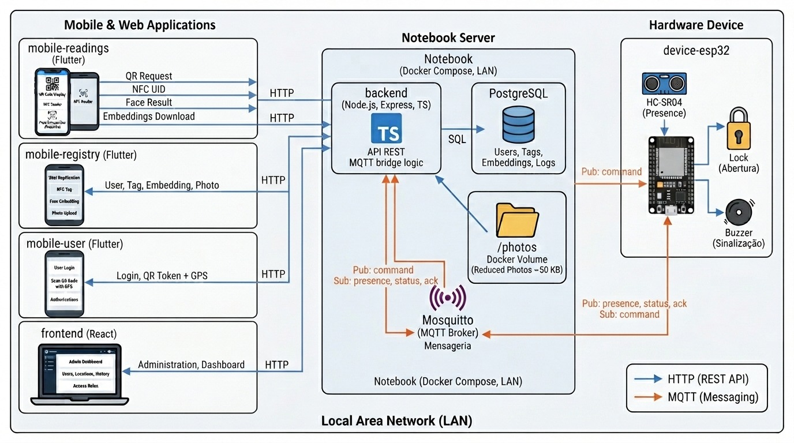
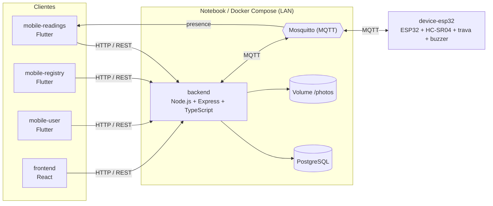
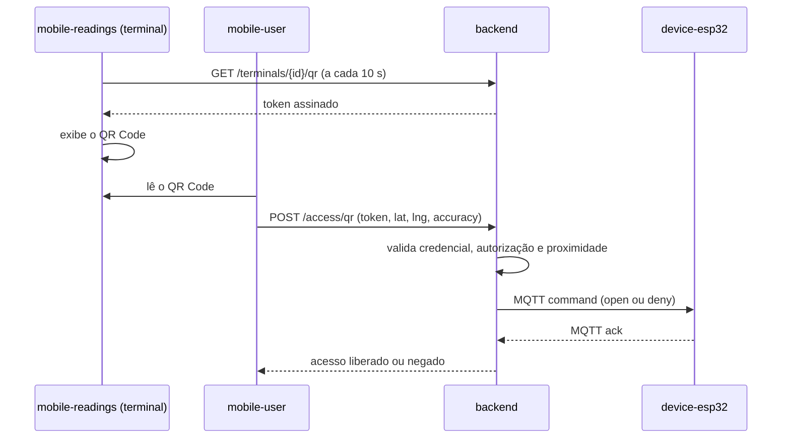
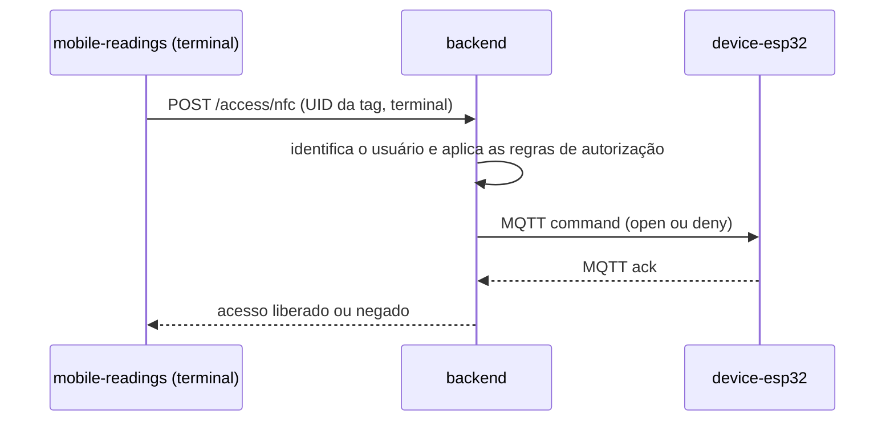
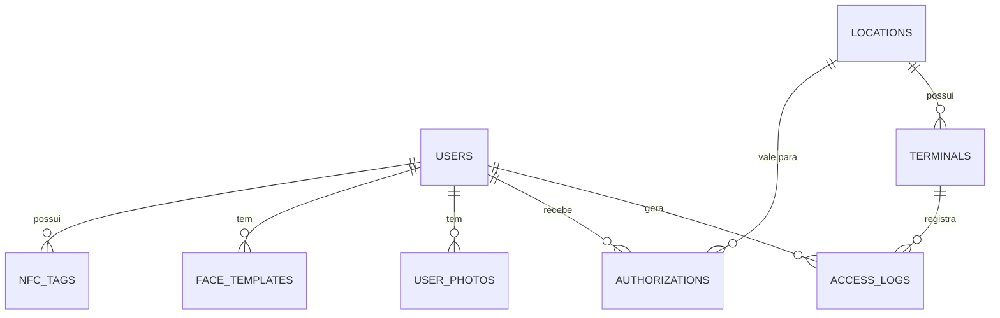

# Arquitetura do access-control

Documentação da arquitetura do Sistema Integrado de Controle de Acesso (ABP 2026-2, 4º DSM, FATEC Jacareí). Atende ao item RP07 do desafio: desenho da arquitetura e descrição da comunicação entre os elementos do sistema.

> Base: [`access-control-visao-geral.docx`](./access-control-visao-geral.docx), que detalha cada serviço. Este documento reúne a visão consolidada. Endpoints e payloads são uma **proposta inicial** e serão refinados na documentação da API.

## 1. Visão geral

O sistema libera uma catraca ou fechadura a partir de uma credencial lida por **QR Code** ou **tag NFC**, com validação centralizada em um backend e registro de toda tentativa de acesso. O **reconhecimento facial** é uma funcionalidade extra (seção 9).

**Princípio central:** apps e dispositivo **nunca decidem o acesso**.

| Quem | Faz |
|---|---|
| Aplicativos e terminal | Coletam a credencial e a encaminham ao backend |
| Backend | Valida, registra o evento e ordena a abertura |
| ESP32 | Obedece ao comando recebido e reporta o que percebe |

A arquitetura é distribuída, com separação clara entre dispositivo, backend e aplicativos (RP05), e foi pensada para rodar inteiramente em **rede local (LAN)**, sem depender de internet na apresentação.

## 2. Diagrama

## 3. Serviços

| Serviço | Tecnologia | Responsabilidade |
|---|---|---|
| `mobile-readings` | Flutter | **Terminal de acesso.** Exibe o QR Code rotativo, lê tags NFC, escuta o evento de presença e mostra o resultado (liberado ou negado). Reconhecimento facial como extra |
| `mobile-registry` | Flutter | **App do administrador.** Cadastro de usuários, vínculo de tags NFC, foto reduzida (cerca de 50 KB) e dado facial |
| `mobile-user` | Flutter | **App do usuário.** Login, leitura do QR Code com geolocalização e lista de autorizações |
| `backend` | Node.js, Express, TypeScript, Prisma, PostgreSQL | **Núcleo do sistema.** Regras de negócio, decisão de acesso, persistência e ponte com o MQTT |
| `frontend` | React | **Painel web.** Usuários, locais, terminais, autorizações, histórico e dashboard |
| `device-esp32` | ESP32, HC-SR04, trava, buzzer | **Dispositivo embarcado.** Detecta presença, aciona a trava e sinaliza com buzzer |

### Módulos do backend

| Módulo | Função |
|---|---|
| `auth` | Login, tokens e controle por perfil |
| `users` | Usuários, tags NFC, dados faciais e foto |
| `locations` | Edifício, portaria, porta, catraca e terminais |
| `authorizations` | Regras de autorização e seu ciclo de vida |
| `access` | Validação de credenciais e **decisão de acesso** |
| `terminals` | QR rotativo, estado, presença e embeddings do terminal |
| `mqtt` | Publicação de comandos e assinatura de eventos |
| `storage` | Abstração de armazenamento de arquivos (`/photos`) |
| `audit` | Registro e consulta do histórico de acessos |

O módulo `access` é o único que reúne a decisão. QR Code, NFC e facial convergem para a mesma função de validação, mudando apenas a forma de identificar a pessoa.

## 4. Comunicação entre os elementos

| Origem | Destino | Protocolo | Uso |
|---|---|---|---|
| Apps e frontend | backend | HTTP / REST | Cadastros, autenticação, validação de acesso, consultas |
| backend | ESP32 | MQTT, via Mosquitto | Comandos de abertura e negação |
| ESP32 | backend | MQTT | Presença, estado e confirmação (ack) |
| ESP32 | mobile-readings | MQTT | Evento de presença (assinatura direta, somente leitura) |
| backend | PostgreSQL | SQL | Dados de usuários, autorizações e histórico |
| backend | disco | Sistema de arquivos | Fotos reduzidas em `/photos` (volume Docker) |

### 4.1 Interfaces HTTP (proposta)

As rotas da API ficam sob o prefixo `/api`.

| Grupo | Endpoints principais | Consumidor |
|---|---|---|
| Autenticação | `POST /auth/login`, `POST /auth/refresh` | Todos os apps |
| Usuários | `GET/POST /users`, `PUT /users/{id}`, `PATCH /users/{id}/status` | mobile-registry, frontend |
| Tags e face | `POST /users/{id}/tags`, `DELETE /users/{id}/tags/{tagId}`, `POST /users/{id}/face`, `GET /users/{id}/photo` | mobile-registry, frontend |
| Locais e terminais | `GET/POST /locations`, `GET/POST /terminals` | frontend |
| Autorizações | `GET/POST /authorizations`, `PATCH /authorizations/{id}/cancel` | frontend |
| Histórico | `GET /access-logs` (com filtros) | frontend |
| Terminal | `GET /terminals/{id}/qr`, `/status`, `/faces` | mobile-readings |
| Acesso | `POST /access/qr`, `/access/nfc`, `/access/face` | mobile-user, mobile-readings |
| Usuário | `GET /me/authorizations` | mobile-user |
| Operação | `GET /health` | Docker, CI/CD, monitoramento |

### 4.2 Tópicos MQTT

| Tópico | Sentido | Conteúdo |
|---|---|---|
| `terminal/{id}/command` | backend → ESP32 | `{action: "open" \| "deny", duration, requestId, expiresAt}` |
| `terminal/{id}/presence` | ESP32 → backend e mobile-readings | `{detected, distance, ts}` |
| `terminal/{id}/status` | ESP32 → backend | `{online, rssi, uptime, lockState}`, com *Last Will* para detectar queda |
| `terminal/{id}/ack` | ESP32 → backend | `{requestId, result, ts}` |

Decisões de projeto: QoS 1 nos comandos; o ESP32 trata `requestId` repetido sem abrir duas vezes; comandos com `expiresAt` vencido são descartados; a duração da abertura tem teto no firmware.

## 5. Fluxos principais

### 5.1 Acesso por QR Code

O backend valida, **nesta ordem**: assinatura do token, expiração, nonce não reutilizado, usuário ativo, autorização existente para o local, situação, janela de datas e horários, usos restantes e proximidade geográfica. O resultado é sempre registrado (RF17).

### 5.2 Acesso por tag NFC

A tag funciona apenas como identificador. Aplicam-se as mesmas regras do QR Code, **sem** o teste de geolocalização, pois a tag foi apresentada fisicamente no terminal.

### 5.3 Presença e modo de escuta

O ESP32 mede a distância com o HC-SR04 e publica `terminal/{id}/presence` ao detectar alguém. O mobile-readings fica em **repouso** (sem câmera nem leitor NFC ativos) e passa ao modo de **escuta** ao receber o evento, reduzindo consumo (RNF07). Se o MQTT falhar, o app consulta `GET /terminals/{id}/status` por polling.

## 6. Modelo de dados (visão inicial)

| Entidade | Campos principais |
|---|---|
| `users` | id, nome, documento, e-mail ou telefone, perfil, senha (hash), ativo |
| `nfc_tags` | id, uid, user_id, ativa |
| `face_templates` | id, user_id, embedding, model_version, data do consentimento |
| `user_photos` | id, user_id, caminho do arquivo, tamanho, tipo |
| `locations` | id, edifício, portaria, porta, catraca, descrição |
| `terminals` | id, location_id, latitude, longitude, segredo do QR, estado, última presença |
| `authorizations` | id, user_id, location_id, data e horário de início e fim, usos permitidos e realizados, situação |
| `access_logs` | id, user_id (nulo se desconhecido), terminal_id, método (QR, NFC ou facial), resultado, motivo, data e hora |

O esquema vigente é o do backend, em `backend/prisma/schema.prisma`; esta seção é uma visão de referência. Pontos de atenção: a contagem de usos é atualizada de forma **atômica**, para que dois acessos simultâneos não ultrapassem o limite, e o embedding fica em coluna própria, o que facilita proteger, excluir e invalidar por `model_version`.

## 7. Segurança

| Tema | Medida |
|---|---|
| Autenticação de pessoas | Login com senha em hash (bcrypt) e token de acesso com expiração |
| Autorização | Rotas administrativas só para administradores; o usuário só acessa os próprios dados |
| Autenticação dos terminais | Chave ou token por terminal, para que só terminais cadastrados enviem `/access/nfc` e `/access/face` |
| QR Code | Token assinado, expiração de cerca de 10 s e nonce de uso único |
| Broker MQTT | Usuário e senha por cliente e ACL por tópico; o tópico `command` só pode ser publicado pelo backend |
| Dados biométricos | Embedding em coluna separada, consentimento registrado e exclusão prevista (LGPD) |
| Fotos | Nome aleatório, validação do conteúdo, limite de tamanho e acesso apenas por endpoint autenticado |
| Entrada de dados | Validação de todos os payloads com esquema (Zod) |
| Abuso | Limite de tentativas no login e nos endpoints de acesso |
| Transporte | HTTPS é o ideal. Na LAN de demonstração, HTTP é aceitável, com a limitação declarada (RNF02) |

> O tópico `terminal/{id}/command` é, na prática, a chave da fechadura. A ACL do Mosquitto deve ser testada antes de cada apresentação.

## 8. Infraestrutura e implantação

- **Entrega final:** execução **local com Docker Compose** (backend, PostgreSQL, Mosquitto e frontend), com volumes para os dados do banco e para `/photos`, em um notebook na LAN (RP12).
- **Desenvolvimento:** o backend também está publicado em uma plataforma de nuvem (Render) para facilitar a integração entre as equipes.
- **Integração e entrega contínuas:** pipeline de CI com build, lint e testes a cada commit, e CD para homologação (RNF08, RNF09, RP09). Planejado; ainda não implantado.
- **Versionamento:** `main` (estável), `approval` e `develop` (integração), com branches de trabalho por prefixo e Pull Requests (RNF11).

## 9. Reconhecimento facial (funcionalidade extra)

O desafio não exige reconhecimento facial. Por decisão do grupo, ele é tratado como **extra**, implementado somente depois que QR Code e NFC estiverem estáveis. Esta decisão está registrada para validação com o professor em [`scrum/PAUTA-PROFESSOR.md`](../scrum/PAUTA-PROFESSOR.md).

- **Cadastro (mobile-registry):** captura de 3 a 5 quadros, geração de embedding no aparelho e envio com a versão do modelo (`modelVersion`), após consentimento registrado.
- **Reconhecimento (mobile-readings):** o app baixa os embeddings autorizados (`GET /terminals/{id}/faces`), compara localmente e envia ao backend apenas o resultado (`POST /access/face`). **Nenhuma imagem trafega durante o acesso.**
- **Requisito crítico:** os dois apps usam o mesmo modelo e o mesmo pré-processamento; do contrário os embeddings não são comparáveis.
- **Limitações:** sem detecção de vivacidade (liveness), podendo ser enganado por foto; sensível à iluminação; o backend confia no resultado da comparação feita pelo terminal, por isso o terminal precisa ser autenticado.

## 10. Decisões e limitações

| Tema | Decisão ou limitação |
|---|---|
| Proximidade (RF13) | Distância **máxima** configurável (padrão 100 m), por fórmula de Haversine, considerando a precisão do GPS enviada pelo app. A redação do enunciado ("pelo menos 100 metros") será confirmada com o professor |
| GPS do terminal (RF11) | Coordenada fixa cadastrada no backend, conforme o RP08 |
| Terminal de Acesso | Tela e leitor NFC no celular (mobile-readings); sensor, trava e buzzer no ESP32. O conjunto compõe o terminal (RF11) |
| Falha de rede | Diretriz: o terminal **nega por padrão** quando não alcança o backend, sem cache de autorizações (opção mais segura) |
| Trava sem energia | A definir entre *fail-secure* e *fail-safe*; na demonstração, a trava permanece fechada |
| Relógio sem internet | Comandos com validade relativa, ou servidor NTP local |
| Armazenamento de fotos | Volume local sem replicação; deve entrar na rotina de backup |
| Plataforma móvel | Android, com instalação direta do APK |

## 11. Requisitos atendidos

| Requisito | Onde |
|---|---|
| RF01 a RF05 | backend, mobile-registry e frontend |
| RF06, RF17 | backend (módulo `audit`) e frontend |
| RF07, RF08 | backend, mobile-user |
| RF09, RF12 | mobile-user (leitura) e backend/mobile-readings (QR rotativo) |
| RF10, RF14 | mobile-readings e backend |
| RF11 | mobile-readings e device-esp32 |
| RF13 | backend (validação) e mobile-user (geolocalização) |
| RF15, RF16 | backend, device-esp32 |
| RNF01, RP05 | Arquitetura em serviços separados (esta página) |
| RNF02 | Seção 7 |
| RNF08 a RNF12, RP09 a RP12 | Seção 8 |
| RP02, RP03 | device-esp32, MQTT |
