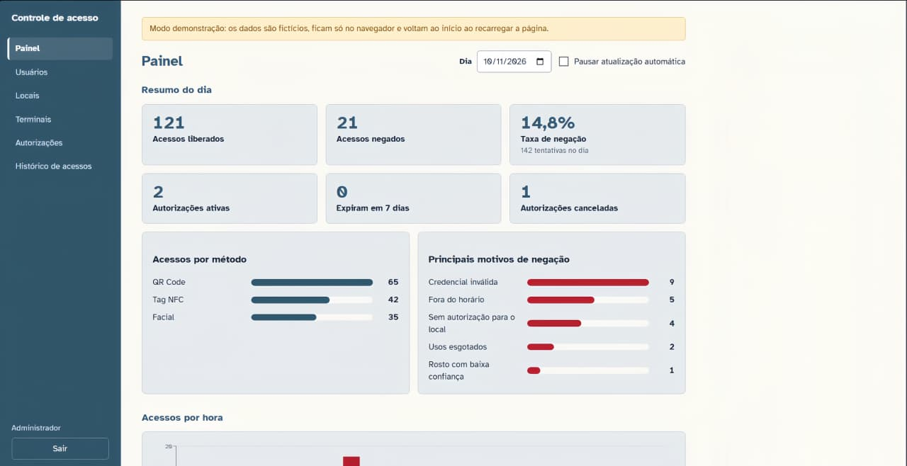
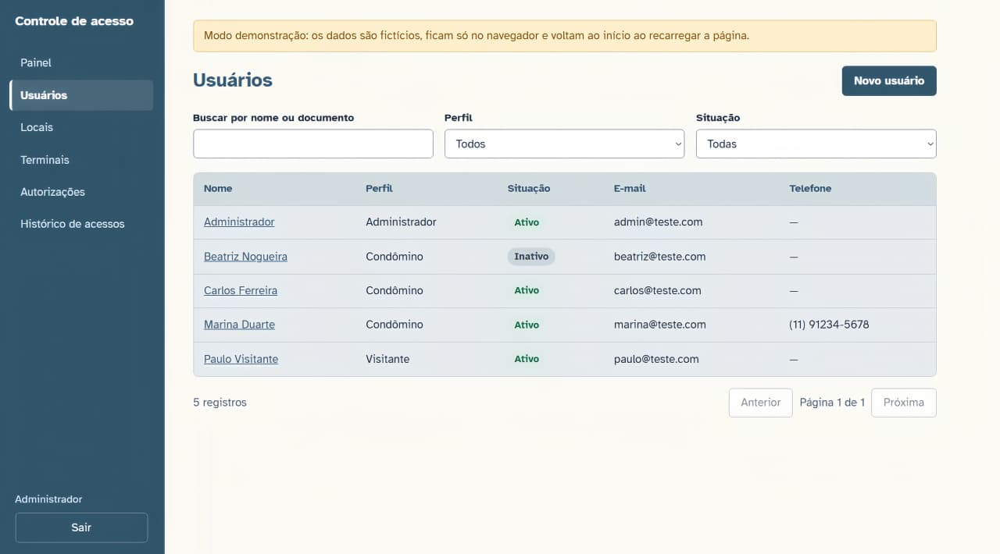
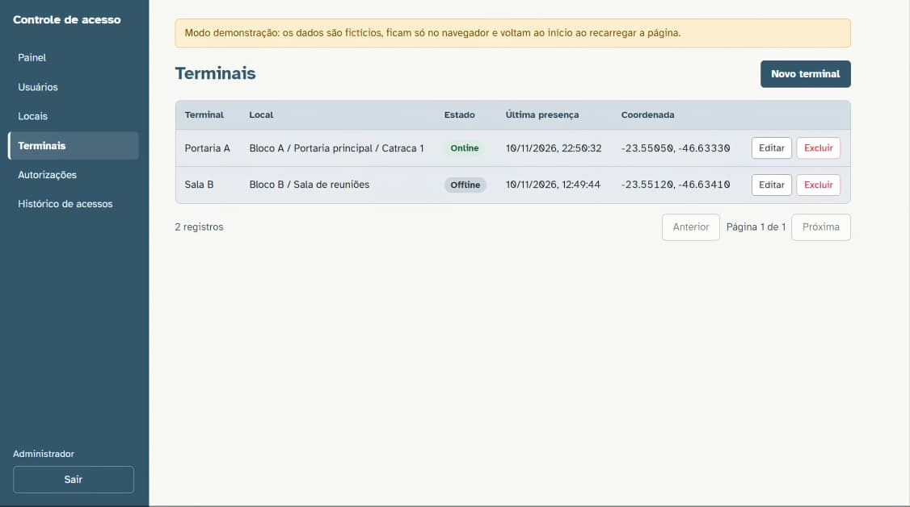
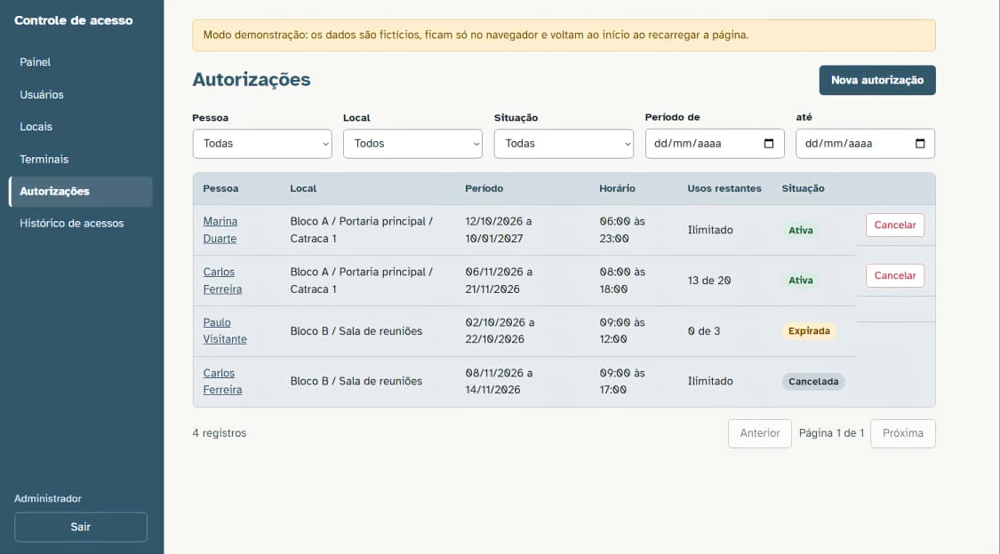
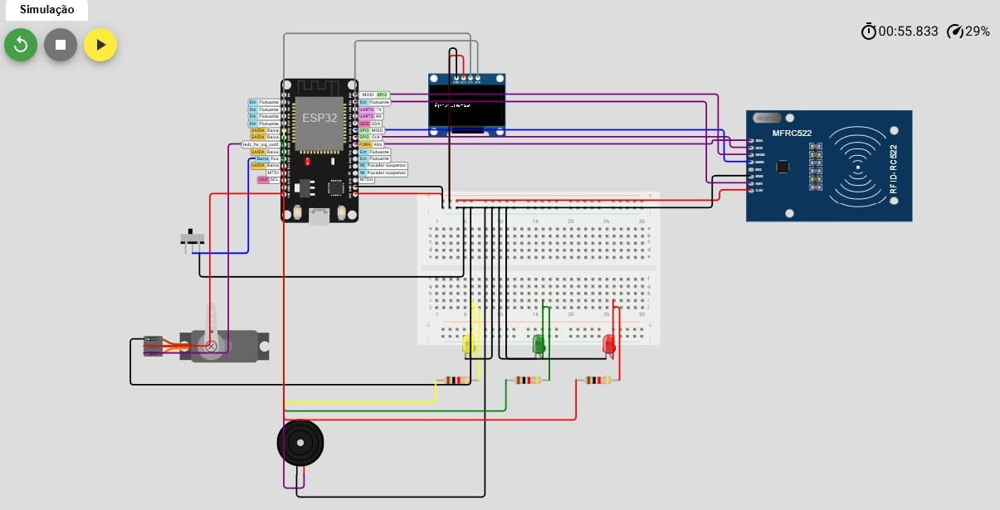
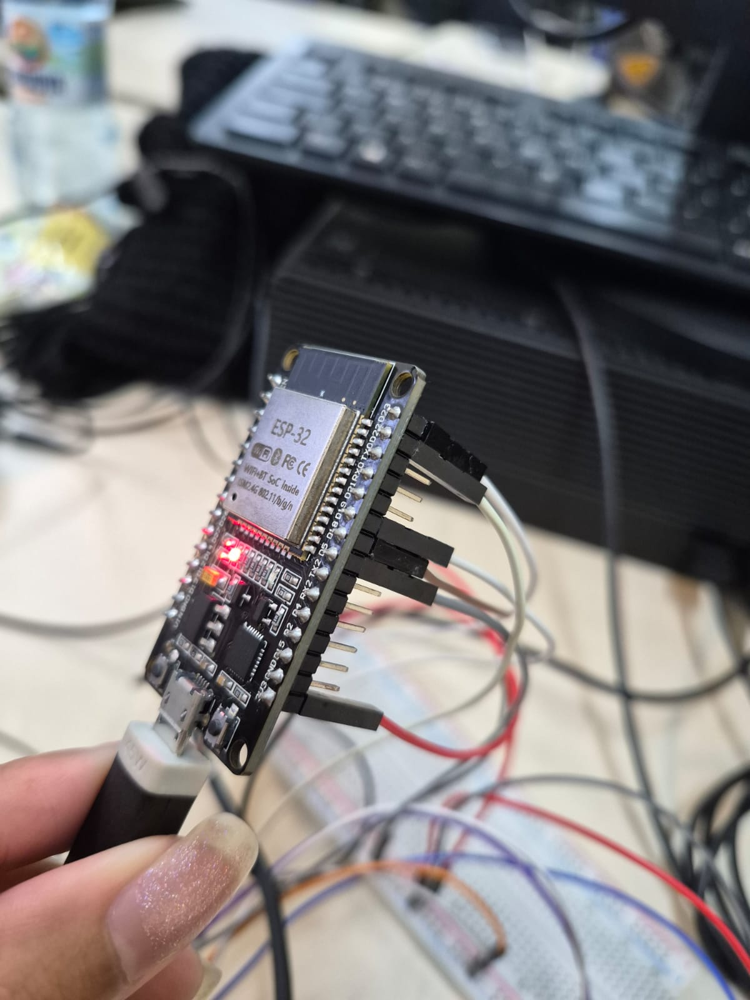
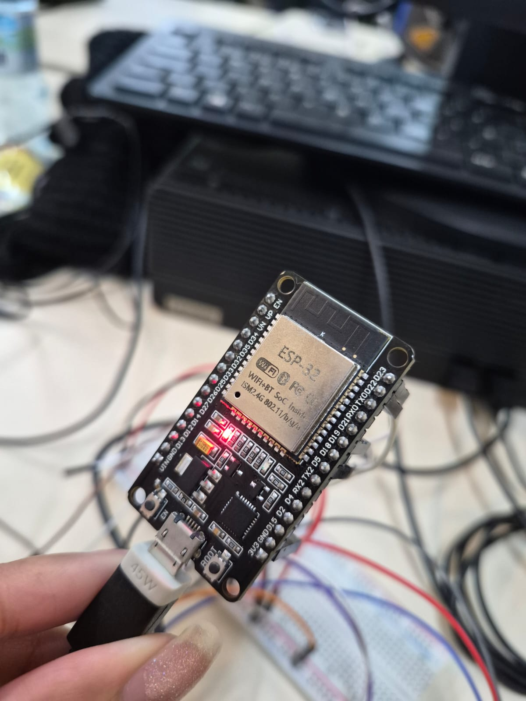
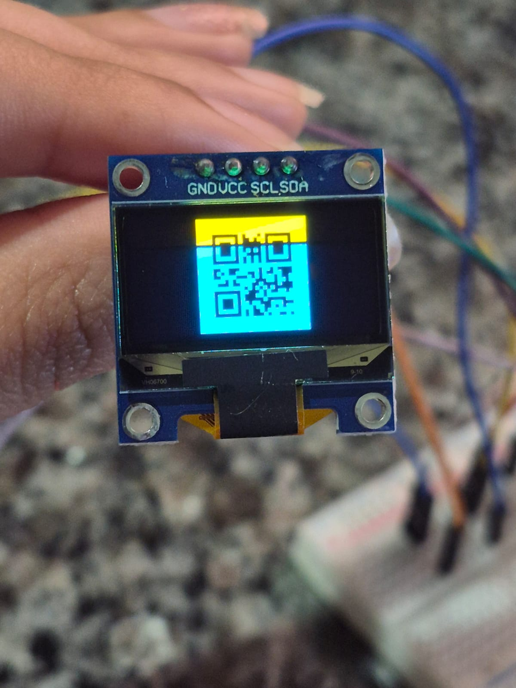
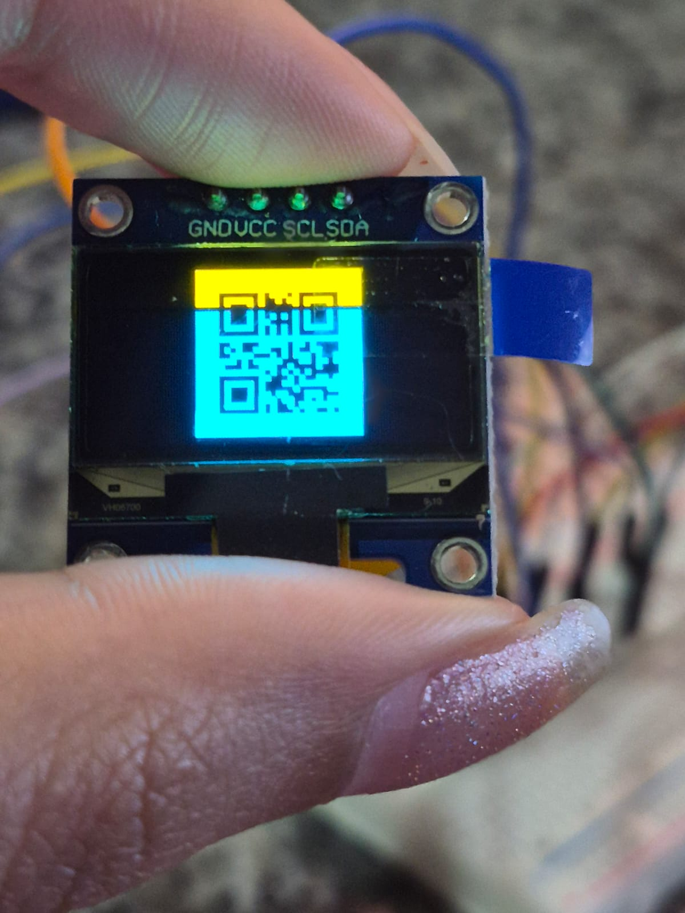
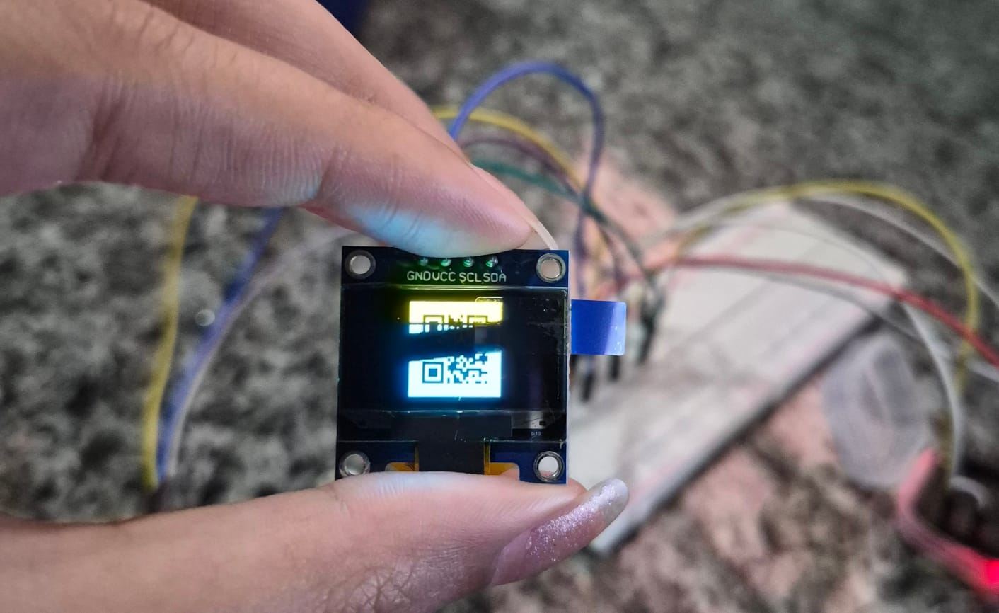

# Evidências da Sprint 2

Registro visual do que foi entregue na Sprint 2 (de 22/10 a 11/11/2026), com o que cada imagem mostra e o que ela **não** comprova. O resultado da sprint está em [`scrum/sprints/sprint-2.md`](../scrum/sprints/sprint-2.md). As imagens ficam em [`imagens/sprint-2/`](./imagens/sprint-2).

## Frontend: painel web do administrador

Responsável: Pedro. As telas abaixo foram capturadas no **modo demonstração** (`npm run dev:mock`), com dados fictícios que voltam ao início ao recarregar a página. Elas mostram a interface, não o painel ligado ao backend: o painel ainda não tem os endpoints de resumo no backend (veja o [README do frontend](../frontend/README.md)).

| Tela | O que mostra |
|---|---|
|  | **Painel.** Resumo do dia (acessos liberados e negados, taxa de negação, autorizações ativas, a expirar e canceladas), acessos por método (QR Code, tag NFC e facial) e principais motivos de negação |
|  | **Usuários.** Lista com busca por nome ou documento, filtros por perfil e situação, e paginação |
|  | **Terminais.** Local de cada terminal, estado online ou offline, última presença e coordenada |
|  | **Autorizações.** Filtros por pessoa, local, situação e período, usos restantes e cancelamento |

## Terminal físico: ESP32

Responsável: Bruna. Detalhes técnicos, pinagem e limitações em [`device-esp32/hardware/README.md`](../device-esp32/hardware/README.md).

### Simulação no Wokwi

Circuito com ESP32, display OLED, leitor RC522, três LEDs com resistor, buzzer, microservo e uma chave que representa a presença. Serviu para testar o fluxo de estados (espera, presença, QR, liberação e negação) antes da montagem física. A simulação não valida as condições elétricas da montagem real.

### Montagem na bancada

| Foto | O que mostra |
|---|---|
|  | ESP32 ligado por cabo USB, com os jumpers conectados e a protoboard ao fundo |
|  | Placa ESP32 energizada, vista de cima |

### Display OLED com QR Code

| Foto | O que mostra |
|---|---|
|  | QR Code exibido no OLED físico, com os pinos GND, VCC, SCL e SDA visíveis |
|  | O mesmo display, em outro ângulo |
|  | O display ligado à protoboard |

O QR Code foi **decodificado a partir de uma fotografia**. A leitura direta pela câmera do celular ainda precisa de ajuste e está planejada para a Sprint 3.

## O que as evidências não comprovam

- O painel do frontend ainda não foi demonstrado ligado ao backend.
- O terminal físico não conversa com o backend: a autorização é simulada pelo monitor serial (comandos `L` e `N`).
- O leitor RC522 passou em teste isolado, mas a integração física aguarda revisão de solda e a avaliação do professor.
- O GPS não foi testado no hardware.
- Não há registro em vídeo ou em captura do fluxo completo entre app, backend e terminal.

O estado de cada requisito está em [`matriz-requisitos.md`](./matriz-requisitos.md).
