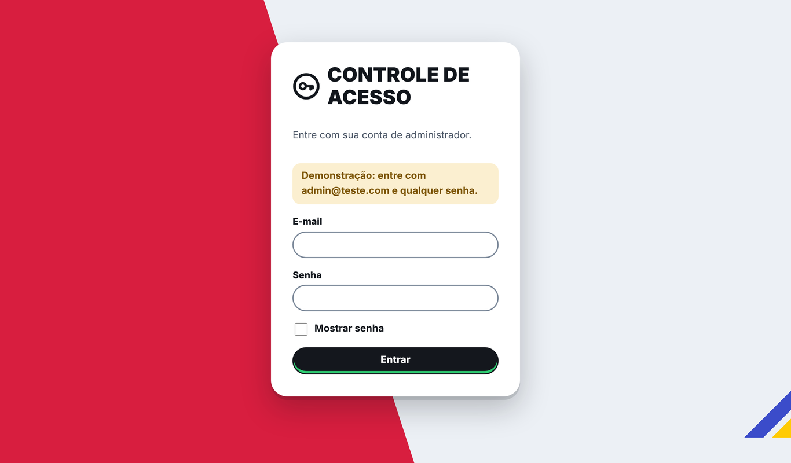
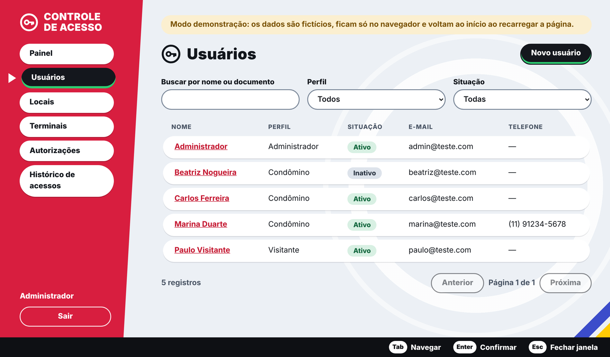
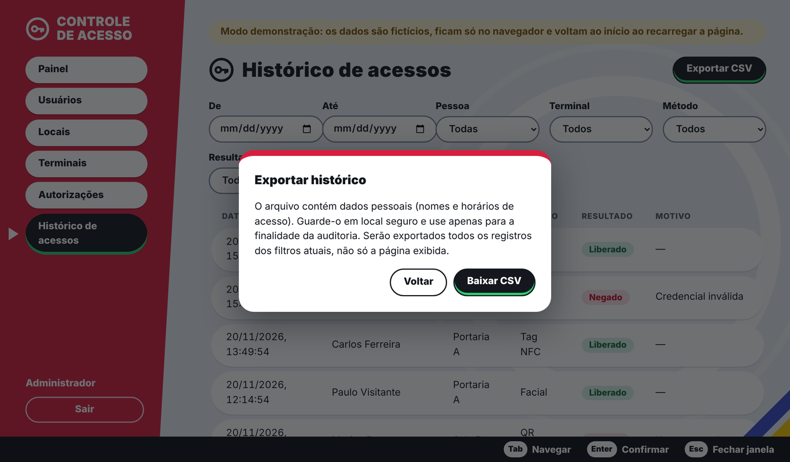
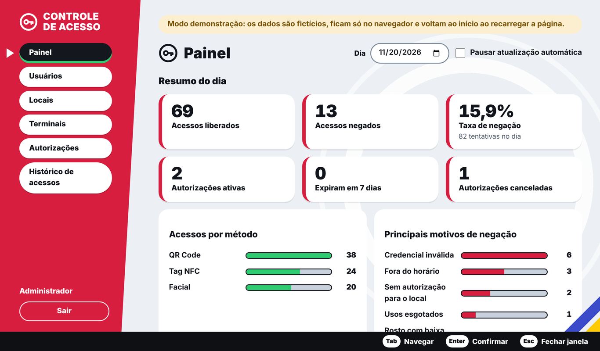
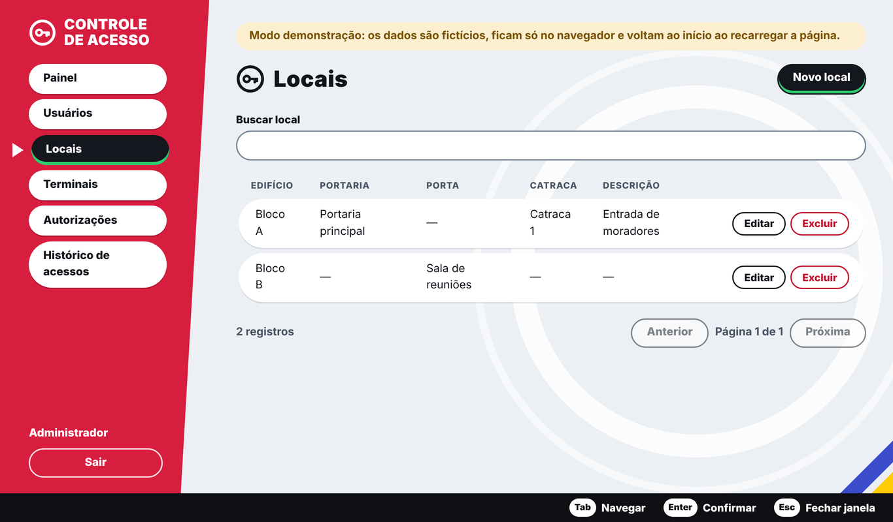
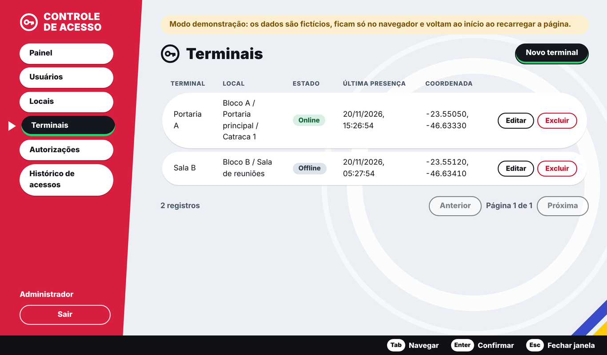
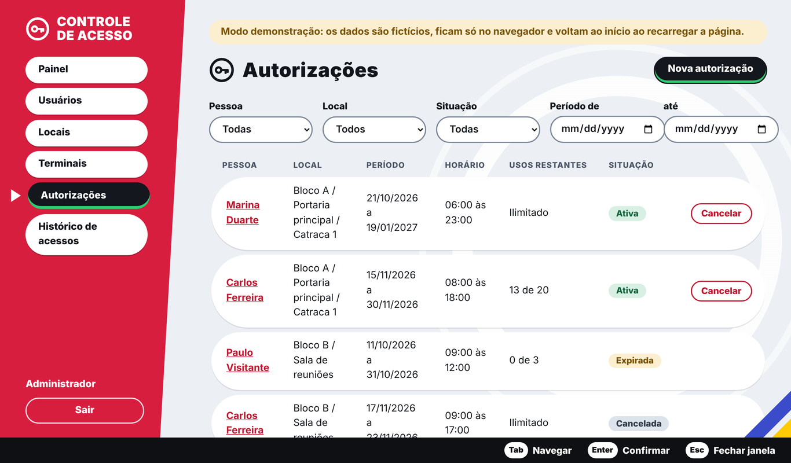
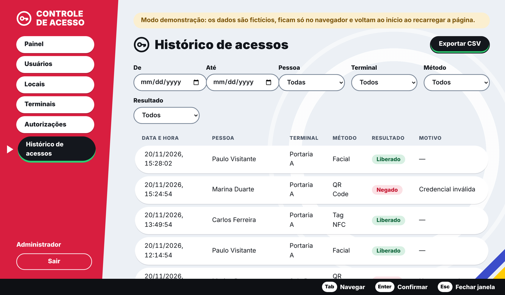
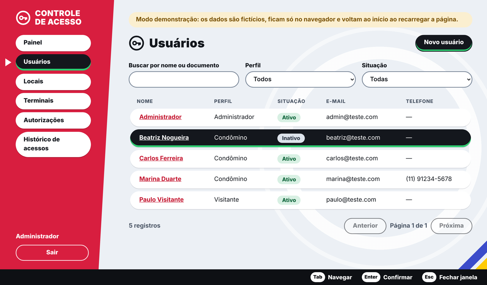

# Documentação do front-end

Especificações visuais e de interface do painel web de administração do **access-control** (Épico 6 do `scrum/BACKLOG.md`).
O código está em `frontend/`. Para rodar o projeto, veja `docs/como-rodar.md` e `frontend/README.md`.

> **Fonte da verdade:** as cores, medidas e fontes abaixo vêm do arquivo `frontend/src/styles.css`.
> Se alguma delas mudar no código, atualize este documento.

## Sumário

1. [Visão geral](#1-visão-geral)
2. [Tecnologias](#2-tecnologias)
3. [Identidade visual](#3-identidade-visual)
4. [Layout](#4-layout)
5. [Componentes](#5-componentes)
6. [Telas](#6-telas)
7. [Acessibilidade](#7-acessibilidade)
8. [Estados da interface](#8-estados-da-interface)
9. [Estrutura de pastas](#9-estrutura-de-pastas)
10. [Como alterar o tema](#10-como-alterar-o-tema)
11. [Histórico de decisões visuais](#11-histórico-de-decisões-visuais)

---

## 1. Visão geral

Interface web para **administradores** gerenciarem o controle de acesso: usuários, locais, terminais, autorizações e
histórico de acessos, além de um painel (dashboard) com o resumo do dia. Só usuários com perfil de administrador entram.

**Conceito visual:** inspirado no estilo de menus de jogos de console. Uma faixa vermelha inclinada à esquerda com o menu,
itens em formato de pílula, o item selecionado em preto com uma seta e uma barra verde, e um rodapé escuro com
as dicas de teclado. Só o estilo é inspirado: o sistema não usa personagens, logotipos nem ícones de nenhum jogo.



## 2. Tecnologias

| Área | Tecnologia |
| --- | --- |
| Base | React 19, TypeScript 5.9, Vite 6 |
| Rotas | React Router 7 |
| Dados da API | TanStack Query 5 |
| Formulários e validação | React Hook Form 7 + zod 4 |
| Gráficos | Recharts 3 (carregado sob demanda, só na tela do painel) |
| Estilos | CSS próprio em `src/styles.css`, com variáveis CSS (sem biblioteca de componentes) |
| Fonte | Nunito (Google Fonts), pesos 500, 600, 700, 800 e 900 |
| Testes | Vitest 5, Testing Library, MSW 3, jsdom |
| Qualidade | ESLint 10 (proíbe `dangerouslySetInnerHTML`) e verificação de tipos |

## 3. Identidade visual

### 3.1 Paleta de cores

Todas as cores ficam como variáveis no início de `src/styles.css` (`:root`).

| Variável | Valor | Onde é usada |
| --- | --- | --- |
| `--red` | `#D81E3F` | Faixa lateral, barra de acento dos cartões do painel, topo e destaque do login, barras de "negado" |
| `--red-dark` | `#B51F2E` | Texto do botão "fantasma" ao passar o mouse (sobre fundo branco) |
| `--canvas` | `#ECF0F5` | Fundo da página |
| `--panel` | `#FFFFFF` | Cartões, linhas de tabela, janelas, formulários, cartão de login |
| `--ink` | `#12161C` | Texto principal |
| `--black` | `#14171D` | Item de menu ativo, botão principal, linha selecionada, aviso temporário (toast), contornos |
| `--muted` | `#4A5565` | Texto secundário, dicas e rótulos de coluna |
| `--field` | `#7A8798` | Borda dos campos de formulário |
| `--green` | `#2ECC71` | Barra de seleção (menu, botão principal, linhas), preenchimento das barras de progresso |
| `--ok` / `--ok-bg` | `#14683F` / `#D8F0E3` | Selo "Ativo", "Liberado", "Online" |
| `--bad` / `--bad-bg` | `#C4152F` / `#FBE1E5` | Links, erros, selo "Negado", botão de excluir |
| `--warn` / `--warn-bg` | `#7A5200` / `#FBEFD0` | Avisos e aviso de modo demonstração |

Cores fixas fora das variáveis:

| Valor | Onde |
| --- | --- |
| `#0E1014` | Rodapé de atalhos de teclado |
| `#DDE3EB` e `#2F3947` | Selo neutro (ex.: "Inativo", "Offline") |
| `#C9D1DC` | Trilho das barras de progresso |
| `#1c6b45` e `#D81E3F` | Gráfico de acessos por hora: liberados e negados (`HoursChart.tsx`) |
| `#FFCB05` e `#3B4CCA` | Duas listras decorativas no canto inferior direito |

### 3.2 Contraste (WCAG 2.1)

Razões de contraste calculadas com a fórmula do WCAG. O mínimo exigido é 4,5:1 para texto normal (nível AA)
e 3:1 para bordas de componentes e elementos gráficos.

| Combinação | Razão | Atende |
| --- | --- | --- |
| Texto principal (`#12161C`) no fundo da página (`#ECF0F5`) | 15,86:1 | AAA |
| Texto principal no cartão branco | 18,15:1 | AAA |
| Texto branco na faixa vermelha (`#D81E3F`) | 5,03:1 | AA |
| Texto branco no preto (`#14171D`) | 17,95:1 | AAA |
| Texto branco no rodapé (`#0E1014`) | 19,04:1 | AAA |
| Texto secundário (`#4A5565`) no cartão branco | 7,56:1 | AAA |
| Texto secundário no fundo da página | 6,60:1 | AA |
| Link e erro (`#C4152F`) no cartão branco | 6,01:1 | AA |
| Link (`#C4152F`) no fundo da página | 5,25:1 | AA |
| Selo OK (`#14683F` em `#D8F0E3`) | 5,68:1 | AA |
| Selo erro (`#C4152F` em `#FBE1E5`) | 4,86:1 | AA |
| Selo aviso (`#7A5200` em `#FBEFD0`) | 6,05:1 | AA |
| Selo neutro (`#2F3947` em `#DDE3EB`) | 9,05:1 | AAA |
| Borda dos campos (`#7A8798`) no branco | 3,65:1 | AA (componente) |
| Verde da barra (`#2ECC71`) no preto | 8,54:1 | AA (gráfico) |

A cor nunca é a única informação: situação, resultado e estado sempre aparecem também como texto
("Ativo", "Negado", "Online").

### 3.3 Tipografia

Família única: **Nunito**, com alternativas do sistema (`system-ui`, `Segoe UI`). Trechos de código usam fonte monoespaçada.

| Elemento | Tamanho | Peso | Observações |
| --- | --- | --- | --- |
| Texto base | 17px (altura de linha 1,5) | 400 (padrão) | Corpo das telas |
| `h1` (título da página) | 2rem (34px) | 900 | Altura de linha 1,15 |
| `h2` (seção) | 1,25rem (21px) | 900 | |
| Marca do menu | 1,3rem | 900 | Caixa alta |
| Item de menu | tamanho base | 800 | |
| Rótulo de campo | 0,95rem | 800 | |
| Dica e texto de apoio | 0,9rem | 400 | Cor `--muted` |
| Rótulo de coluna da tabela | 0,8rem | 800 | Caixa alta, espaçamento de letras 0,06em |
| Número grande do painel | 2,3rem | 900 | |
| Dicas de teclado (rodapé) | 0,95rem | 800 | |

### 3.4 Formas, bordas e sombras

| Elemento | Especificação |
| --- | --- |
| Botões, campos, itens de menu, selos | Formato de pílula (`border-radius: 999px`) |
| Cartões e formulários | Raio de 22px, sombra sólida suave de 3px (`rgba(20,23,29,.08)`) |
| Janelas (modal) | Raio de 26px, borda superior vermelha de 10px |
| Cartão de login | Raio de 28px |
| Raio padrão (`--radius`) | 14px (avisos, caixas internas) |
| Campos | Borda de 2px; no foco a borda escurece para `--black` |
| Botões | Borda de 2px preta |

### 3.5 Elementos decorativos

- **Círculos grandes ao fundo:** anéis claros semitransparentes, fixos, desenhados com gradiente CSS no `body`.
- **Ícone do sistema:** um desenho próprio (chave dentro de um círculo), usado no menu, no login e ao lado do título de cada página
  (`src/shared/Logo.tsx`). É decorativo e fica oculto para leitores de tela.
- **Listras no canto inferior direito:** duas listras diagonais (amarela `#FFCB05` e azul `#3B4CCA`), pequenas (70 a 96px),
  fixas acima do rodapé. Não recebem cliques, e não aparecem na tela de login, em telas estreitas (até 860px) nem na impressão.

## 4. Layout

### 4.1 Estrutura geral

```
┌──────────────┬─────────────────────────────────────────────┐
│ Faixa        │  Aviso de modo (se houver)                  │
│ vermelha     │  [ícone] Título da página        [Ação]     │
│ 320px        │                                             │
│ (fixa)       │  Conteúdo da tela                           │
│              │  (cartões, filtros, tabelas)                │
│  Menu        │                                             │
│  Usuário     │                                             │
│  [Sair]      │                                             │
├──────────────┴─────────────────────────────────────────────┤
│ Rodapé preto: Tab Navegar · Enter Confirmar · Esc Fechar    │
└────────────────────────────────────────────────────────────┘
```

| Parte | Especificação |
| --- | --- |
| Grade principal | Duas colunas: barra lateral de **320px** e conteúdo flexível |
| Barra lateral | Vermelha, altura da janela, fixa ao rolar; borda direita inclinada (corte de 46px) |
| Menu | Pílulas brancas empilhadas com espaço de 0,5rem; o ativo é preto com barra verde de 5px embaixo e seta branca à esquerda |
| Rodapé do menu | Nome do usuário logado e botão "Sair" |
| Conteúdo | Largura máxima de 1240px; espaçamento lateral entre 1,25rem e 2,75rem (`clamp`) |
| Cabeçalho da página | Ícone + título à esquerda, ações à direita; quebra de linha em telas estreitas |
| Rodapé de atalhos | Fixo na parte de baixo, 44px, fundo `#0E1014`, alinhado à direita |

### 4.2 Responsividade

| Largura | O que muda |
| --- | --- |
| Acima de 860px | Layout completo em duas colunas |
| Até 860px | Barra lateral vira um bloco no topo (sem corte inclinado, sem seta); menu em linha com quebra; formulários e perfil em uma coluna; rodapé centralizado; login com a faixa vermelha no topo |
| Tabelas largas | Rolagem horizontal dentro do próprio cartão |

Preferência por movimento reduzido: animações e transições são desligadas.

### 4.3 Espaçamento

Sem uma escala fixa de pixels: os espaços usam `rem` em múltiplos de 0,25. Os mais usados:
0,5rem (entre itens de menu e botões), 0,75rem a 1rem (entre campos), 1,25rem (entre blocos empilhados),
1,4rem a 1,6rem (preenchimento de cartões e formulários) e 2rem (margem do conteúdo).

## 5. Componentes

### 5.1 Botões

| Tipo | Classe | Aparência |
| --- | --- | --- |
| Padrão | `.btn` | Fundo branco, borda e texto pretos |
| Principal | `.btn-primary` | Fundo preto, texto branco, barra verde embaixo |
| Perigo | `.btn-danger` | Borda e texto vermelhos; ao passar o mouse, fundo vermelho e texto branco |
| Fantasma | `.btn-ghost` | Transparente com borda branca (usado sobre a faixa vermelha, ex.: "Sair") |
| Pequeno | `.btn-sm` | Altura de 36px (linhas de tabela) |
| Largura total | `.btn-block` | Ocupa toda a largura (login) |

Altura mínima de 44px (36px no pequeno). Desabilitado: opacidade de 50% e cursor "não permitido".

### 5.2 Campos de formulário

Rótulo em negrito acima do campo, dica opcional abaixo e mensagem de erro em vermelho (`role="alert"`).
Campos em pílula com 46px de altura mínima; área de texto com raio de 14px. A validação vem do zod
e as mensagens aparecem em português ao lado de cada campo.

### 5.3 Tabelas

Cada linha é uma pílula branca com sombra, separada por 8px. Rótulos de coluna em caixa alta, cinza.
Ao passar o mouse ou focar com o teclado, a linha inteira fica **preta com texto branco e barra verde embaixo**.
A coluna de ações fica à direita, com botões pequenos. Paginação abaixo: "Anterior", "Página X de Y", "Próxima",
com o total de registros.



### 5.3.1 Selos (badges)

Pílulas pequenas com texto em negrito: verde (`badge-ok`), vermelho (`badge-bad`), amarelo (`badge-warn`) e cinza (`badge-muted`).

### 5.4 Cartões e painel

Cartão branco de raio 22px (`.panel`). No painel, os números do resumo ficam em cartões com uma **barra vermelha de 8px à esquerda**,
número grande (2,3rem) e rótulo em negrito. As barras de progresso (acessos por método, motivos de negação)
têm trilho cinza, borda preta de 2px e preenchimento verde (ou vermelho para negações).

### 5.5 Janelas (modal) e confirmações

Usam o elemento nativo `<dialog>`: foco preso dentro da janela, fecha com **Esc**, fundo escurecido. Largura de 540px
(740px na versão larga), topo vermelho de 10px. Ações destrutivas (excluir, cancelar autorização, remover tag, apagar dados biométricos)
sempre pedem confirmação.



### 5.6 Avisos

| Tipo | Aparência |
| --- | --- |
| Aviso temporário (toast) | Pílula preta com barra verde, canto inferior direito, some sozinha em 5 segundos |
| Aviso de modo | Pílula amarela no topo do conteúdo: "Modo demonstração" ou modo de desenvolvimento |
| Erro de formulário | Caixa vermelha clara com texto vermelho |
| Erro de carregamento | Cartão com borda vermelha contínua e botão para tentar de novo |

### 5.7 Rodapé de atalhos

Barra preta fixa com três dicas em formato de tecla: **Tab** Navegar, **Enter** Confirmar, **Esc** Fechar janela.
Só mostra atalhos que funcionam no navegador.

## 6. Telas

Todas as rotas, exceto `/login`, exigem usuário administrador logado. Qualquer endereço desconhecido leva a `/painel`.

| Tela | Rota | Conteúdo |
| --- | --- | --- |
| Login | `/login` | E-mail, senha e opção "Mostrar senha"; cartão branco sobre fundo dividido em diagonal, vermelho e claro |
| Painel | `/painel` | Resumo do dia, acessos por método, motivos de negação, gráfico por hora, status dos terminais e últimos acessos |
| Usuários | `/usuarios` | Lista com busca por nome ou documento, filtros de perfil e situação; botão "Novo usuário" |
| Novo / editar usuário | `/usuarios/novo`, `/usuarios/:id/editar` | Nome completo, e-mail (usado no login), perfil, documento e telefone (opcionais) |
| Detalhe do usuário | `/usuarios/:id` | Dados (documento parcialmente oculto), foto, autorizações, tags NFC (vincular e remover) e reconhecimento facial (excluir dados biométricos) |
| Locais | `/locais` | Lista com edifício, portaria, porta, catraca e descrição; criar, editar e excluir em janela |
| Terminais | `/terminais` | Lista com local, estado (online ou offline), última presença e coordenada; criar, editar e excluir |
| Autorizações | `/autorizacoes` | Lista com pessoa, local, período, horário, usos restantes e situação; nova autorização e cancelamento |
| Detalhe da autorização | `/autorizacoes/:id` | Dados completos e botão "Cancelar autorização" |
| Histórico de acessos | `/historico` | Filtros por pessoa, terminal, método, resultado e período; tabela paginada; botão "Exportar CSV" |

### Painel



- **Cartões de resumo:** acessos liberados, acessos negados, taxa de negação, autorizações ativas, autorizações que expiram em 7 dias e autorizações canceladas.
- **Seletor de dia** e opção de pausar a atualização automática (terminais e últimos acessos atualizam a cada 5 segundos).
- **Gráfico por hora:** barras de liberados e negados nas 24 horas, com uma tabela equivalente para leitores de tela. O dia vai de 00:00 a 24:00 no horário de São Paulo.

Imagem da página inteira: [painel completo](imagens/frontend/03-painel-completo.png).

### Demais telas






As imagens foram geradas no modo demonstração (`npm run dev:mock`), com dados fictícios.

## 7. Acessibilidade

| Item | Como é atendido |
| --- | --- |
| Contraste | Todos os pares de texto passam de 4,5:1 (ver seção 3.2) |
| Foco visível | Contorno de 3px; preto sobre fundos claros e branco sobre a faixa vermelha, o rodapé e as linhas selecionadas |
| Teclado | Toda a interface é operável por **Tab**, **Enter** e **Esc** (janelas nativas `<dialog>`) |
| Estrutura | Um `h1` por página; navegação com `aria-label="Principal"`; paginação com `aria-label="Paginação"` |
| Estados anunciados | Carregando com `role="status"`; erros com `role="alert"` |
| Gráfico | O gráfico por hora tem uma tabela equivalente para leitores de tela |
| Ícones decorativos | `aria-hidden`, sem texto alternativo |
| Cor não é a única pista | Situação e resultado também aparecem como texto |
| Alvos de toque | Botões com altura mínima de 44px (36px nos pequenos das tabelas) |
| Movimento | Respeita `prefers-reduced-motion` |

Ainda não foi feita uma revisão com leitor de tela (US-18): os itens acima foram conferidos pelo código e por testes automatizados.

## 8. Estados da interface

| Situação | O que o usuário vê |
| --- | --- |
| Carregando | Texto "Carregando…" no lugar do conteúdo |
| Lista vazia | Nas listas, cartão tracejado com a mensagem da tela (ex.: "Nenhuma tentativa de acesso encontrada com esses filtros."); nos cartões do painel, texto cinza (ex.: "Nenhum acesso registrado neste dia.") |
| Erro de carregamento | Cartão com borda vermelha, mensagem e botão para tentar de novo |
| Erro ao salvar | Mensagem vermelha dentro do formulário ou da janela |
| Sucesso | Aviso temporário (toast) por 5 segundos |
| Sessão expirada (401 `UNAUTHORIZED` ou `INVALID_TOKEN`) | Volta ao login com a mensagem "Sua sessão expirou. Entre novamente." |
| Campo opcional vazio | Mostra "—" |
| Outros erros da API (ex.: 403 sem permissão) | A mensagem devolvida pela API aparece no cartão de erro ou no formulário |

## 9. Estrutura de pastas

```
frontend/
├── index.html              # carrega a fonte Nunito
├── public/                 # favicon e config.json (endereço da API em tempo de execução)
└── src/
    ├── styles.css          # todo o CSS e as variáveis de cor
    ├── Layout.tsx          # faixa lateral, menu, rodapé de atalhos
    ├── App.tsx             # rotas
    ├── features/           # uma pasta por área: auth, dashboard, users, locations, authorizations, access-logs
    ├── shared/             # api.ts, ui.tsx (botões, modal, paginação), Logo.tsx, mock.ts, format.ts
    └── test/               # configuração de testes e dados de exemplo
```

## 10. Como alterar o tema

1. Abra `frontend/src/styles.css` e edite as variáveis no bloco `:root` (início do arquivo).
2. Cores do gráfico por hora: `frontend/src/features/dashboard/HoursChart.tsx` (`GRANTED` e `DENIED`).
3. Fonte: troque o link em `frontend/index.html` e a propriedade `font-family` em `:root`.
4. Listras do canto: bloco `body::after` no fim do `styles.css` (tamanho em `width`, cores em `background`).
5. Depois de mudar cores, confira o contraste (seção 3.2) e rode `npm run check`.

Cada classe de componente (`.btn`, `.panel`, `.badge`, `.modal`, …) está no mesmo arquivo, então não há outros lugares com estilo.

## 11. Histórico de decisões visuais

| Versão | Identidade | Observação |
| --- | --- | --- |
| 1 | Cores da Fatec: azul petróleo `#31566A`, vermelho `#B51F2E`, off-white `#F7F7F4`, cinza azulado `#E5EBEE`; fonte Atkinson Hyperlegible | Primeira versão, a mesma paleta do aplicativo mobile |
| 2 (atual) | Estilo de menu de jogo, descrito neste documento | Pedido de redesign. Para voltar à paleta da Fatec, troque `--red` por `#B51F2E` e ajuste `--canvas` e `--black` para os valores da versão 1 |

Tela do menu com a linha selecionada:


